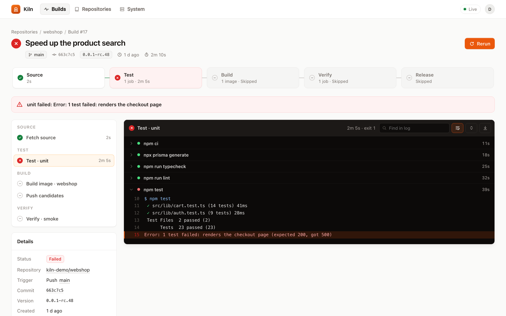
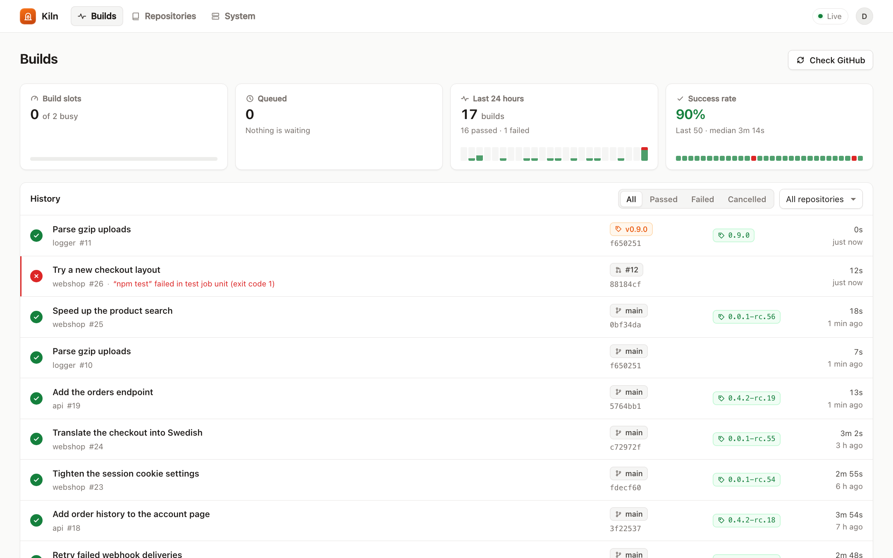
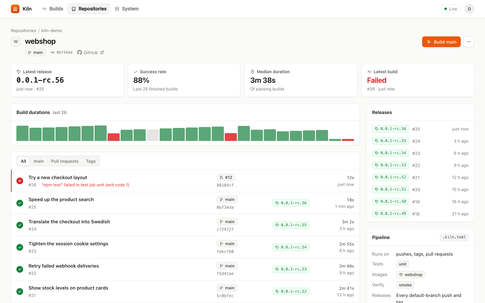

# Kiln

**Self-hosted CI for private GitHub repositories, running on your own Kubernetes cluster.**

Kiln watches the repositories its GitHub App is installed on. For every repository with a `.kiln.toml` it runs the tests on pull requests, builds container images with BuildKit, smoke-tests the image it just built, and publishes a semver tag to your registry for GitOps image automation to deploy. Results appear as GitHub checks and in Kiln's own web UI.

<picture>
  <source media="(prefers-color-scheme: dark)" srcset="docs/images/build-dark.png">
  
</picture>

## Why Kiln

- **One small service, no runners to register.** Kiln is a single Rust binary. Every build is one short-lived pod, and a fixed number of build slots is shared by all your repositories.
- **Releases that continue your versions.** A push to the default branch releases `X.Y.(Z+1)-rc.N` above anything already in the registry, and a `vX.Y.Z` tag on a tested commit releases that exact image. Flux and Argo CD image automation pick it up.
- **Credentials stay contained.** The registry credential only reaches the push step. Pull requests never receive secrets, tags must be reachable from the default branch to be trusted, and secrets are masked in logs. Build pods run without a service account token, behind network policies and an admission policy.
- **Built to be left alone.** Polling with conditional requests means a lost webhook never loses a build. Kiln re-attaches to running builds after a restart, retries infrastructure failures, and warns when something else publishes to your registry.

## A repository opts in with one file

```toml
version = 1

[[images]]
name = "web"
args = { DEPLOYMENT_ID = "${sha}" }

[test.unit]
image = "node:26"
cache = ["/root/.npm"]
steps = ["npm ci", "npm test"]

[verify.smoke]
image = "curlimages/curl:8"
steps = ["curl --fail --retry 10 --retry-connrefused http://127.0.0.1:3000/health"]
services = [{ name = "app", candidate = "web" }]
```

Every build goes through **test → build → verify → release**. Pull requests stop after the tests. The [configuration reference](docs/config.md) covers multiple images, build secrets, services, caches, tag-only releases and shadow mode for migrating from another CI.

## Try it in a minute

```bash
docker run --rm -p 8080:8080 ghcr.io/mikaelhug/kiln:0.1.3 demo --bind 0.0.0.0
```

Open <http://localhost:8080> and choose **Enter the demo**. The demo runs the real engine and UI against simulated repositories with a few days of history; nothing outside your machine is contacted. With Rust installed, `cargo run -p kiln -- demo` does the same from a checkout.

<table>
  <tr>
    <td width="50%">
      <picture>
        <source media="(prefers-color-scheme: dark)" srcset="docs/images/builds-dark.png">
        
      </picture>
    </td>
    <td width="50%">
      <picture>
        <source media="(prefers-color-scheme: dark)" srcset="docs/images/repository-dark.png">
        
      </picture>
    </td>
  </tr>
</table>

## Install

Kiln needs a Kubernetes cluster (1.33 or newer, with user namespaces and network policies), an OCI registry such as GitHub Container Registry, and a public HTTPS address for the UI and webhooks. The [requirements](docs/operations.md#requirements) list the details.

1. **Create the GitHub App.** `kiln setup --url https://kiln.example.com` creates it from a manifest and writes its credentials as Kubernetes Secrets.
2. **Deploy.** Copy [`deploy/kubernetes`](deploy/kubernetes) into your GitOps repository, fill in the values and apply it.
3. **Onboard a repository.** Install the app on it and commit a `.kiln.toml`, first with `shadow = true` to compare against your current CI.

[Operating Kiln](docs/operations.md) walks through each step, the cluster requirements, every setting and a runbook. [Design](docs/design.md) explains how Kiln works and why.

## Command line

The `kiln` binary is both the server and a local tool. Download it from the [releases](https://github.com/mikaelhug/kiln/releases) or build it with `cargo install --git https://github.com/mikaelhug/kiln kiln`.

```bash
kiln validate
kiln plan --event push --published 0.0.1-rc.55
kiln plan --event tag:v1.0.0
kiln schema > kiln.schema.json
```

`validate` checks `.kiln.toml`, including the secret mounts its Dockerfiles expect. `plan` shows what would run for an event and which version it would release. `schema` prints the JSON Schema that editors use for completion.

## Status

Kiln is young. It runs real workloads, but expect rough edges, and read the [security policy](SECURITY.md) before exposing it to the internet. Kiln ships `linux/amd64` and `linux/arm64` images of itself and builds your images for whichever platforms you list.

## Contributing

Issues and pull requests are welcome; see [CONTRIBUTING.md](CONTRIBUTING.md). `just check` runs formatting, clippy, the no-comments rule, the tests and the schema drift check.

## License

Kiln is dual-licensed under the [MIT License](LICENSE-MIT) or the [Apache License 2.0](LICENSE-APACHE), at your option. Unless you state otherwise, any contribution you submit is licensed the same way, without additional terms.
